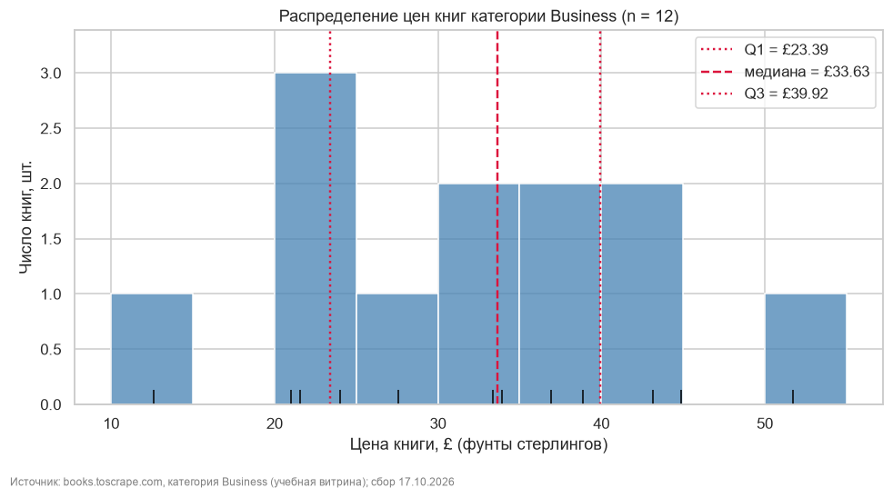
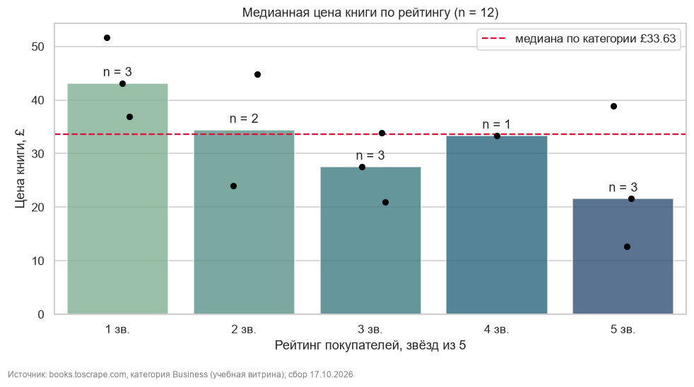
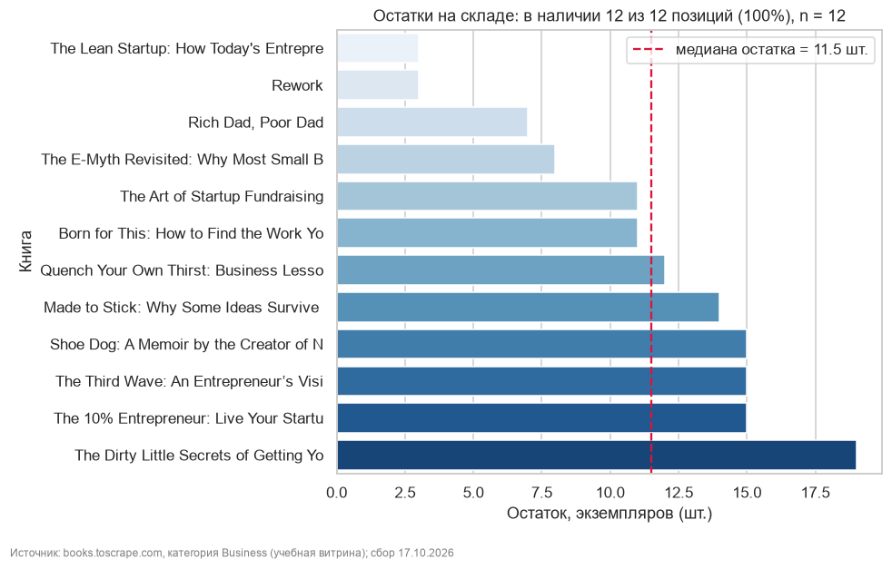
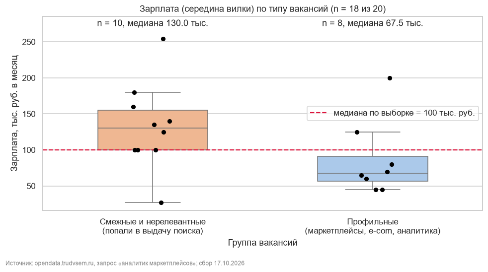

# Практическая работа № 1. Открытые API, парсинг HTML и регулярные выражения

**Дисциплина:** «Программные средства сбора, консолидации и аналитики данных».
**Вариант 2 · E-commerce:** «Ценовое позиционирование в нише деловой литературы».

| | |
|---|---|
| **API** | «Работа в России» (`opendata.trudvsem.ru`), запрос «аналитик маркетплейсов», без ключа |
| **Сайт для парсинга** | `books.toscrape.com`, категория Business (учебная витрина) |
| **Метрики варианта** | распределение цен, медиана цены по рейтингу, доля товаров в наличии, boxplot зарплат |
| **Дата сбора** | 17.10.2026 |
| **Стек** | `requests` + `urllib3.Retry`, `BeautifulSoup4`, `lxml` (XPath), `re`, `pandas`, `matplotlib`, `seaborn` |

## Содержимое репозитория

| Файл / папка | Что это |
|---|---|
| [`pw_01_variant2_completed.ipynb`](pw_01_variant2_completed.ipynb) | Основной ноутбук со всеми выводами ячеек |
| [`images/`](images/) | Графики из ноутбука для этого README |
| [`pw1_snapshots/`](pw1_snapshots/) | Parquet-снимки каталога и вакансий (задание со звёздочкой D) |

## Как запустить

1. Нажмите кнопку **Open in Colab** выше или откройте ноутбук в Jupyter.
2. В ячейке «Шаг 1» проверьте параметры:
   * `VARIANT = 2`;
   * `CONTACT_EMAIL` — адрес передаётся в `User-Agent`;
   * `REQUEST_PAUSE = 0.5`.
3. Выполните **«Среда выполнения» → «Выполнить все»**. Ячейки идут строго сверху вниз.
4. Ключи и токены не нужны: оба источника открытые.

Ответы кэшируются в папке `pw1_cache/`. Она исключена из репозитория через `.gitignore`: в сырых ответах API есть контакты работодателей. Свежие данные можно получить, если очистить кэш или выставить `USE_CACHE = False`.

## Что сделано

| Этап | Реализация | Результат |
|---|---|---|
| 1. REST API | Пагинация (`offset` — номер страницы), остановка на неполной странице, паузы, повторы с экспоненциальной задержкой, обработка ошибок, журнал запросов | 20 уникальных вакансий |
| 2. HTML | Разбор CSS-селекторами (BeautifulSoup) и XPath (lxml), сверка по всем полям; страницы товаров через XPath `following-sibling` | 12 из 12 книг, 0 расхождений |
| 3. Очистка | 6 RegEx-функций (цена, остаток, рейтинг, зарплатная вилка, навыки, дата), 10 общих и 17 собственных тестов | Распознано 100 % применимых значений |
| 4. Анализ | Типизированные `DataFrame`, проверка пропусков и дубликатов, медианы и квартили, 4 графика | См. ниже |
| ★ E | Тесты, ломающие разметку (нет цены, изменён класс, пустой ответ и др.) | 11 из 11 тестов, 0 падений |
| ★ D | Снимки в parquet, повторный сбор, таблица изменений, контрольный пример | Изменений между запусками нет: витрина статична |

### Почему объём меньше ориентира (50 API / 40 HTML)

* **API.** Портал сам сообщает `meta.total = 20` по запросу варианта. Первая страница с `limit = 100` пришла неполной, значит, это все доступные записи.
* **HTML.** В категории Business сайт показывает «12 results», страница 2 отвечает 404. Собрана вся категория.

Записи не дублировались, вариант не менялся. Доказательства выводятся в ноутбуке на шагах 2–3 и в самопроверке.

## Результаты

### Цены конкурента

Медиана **£33.63**, половина ассортимента — в коридоре **£23.39–39.92**, диапазон £12.61–51.74 (n = 12).

### Цена и рейтинг

Премии за рейтинг не видно. Медиана цены книг с 5 звёздами — £21.59, с 1 звездой — £43.14. В каждой группе 1–3 книги, поэтому это гипотеза, а не закономерность.

### Наличие

В наличии 12 из 12 позиций (100 %). Остаток — от 3 до 19 шт., медиана 11,5 шт.

### Зарплаты

Поиск портала возвращает и нерелевантные вакансии, поэтому выдача разделена на профильные и смежные.

* **Профильные:** 9 из 20; медиана **67 500 руб./мес** (Q1–Q3: 56 250–91 250). В Москве и МО — 97 500 руб., в регионах — 62 500 руб.
* **Смежные:** медиана 130 000 руб. Общая медиана 100 000 руб. ими завышена.

## Выводы и рекомендации

1. **Базовую цену деловой литературы ставить в коридоре £23–34**, то есть от Q1 до медианы конкурента. Проверка: еженедельный мониторинг цен и сравнение конверсии в течение 4 недель.
2. **Не закладывать наценку за высокий рейтинг**, использовать рейтинг в продвижении. Проверка: собрать весь каталог (около 1000 книг) и посчитать ранговую корреляцию «рейтинг — цена».
3. **Бюджет на аналитика маркетплейсов — от 67 500 руб./мес; рассмотреть найм в регионах.** В требованиях к кандидату указывать опыт работы с Ozon и Wildberries и уверенный Excel. Это самые частые требования в текстах вакансий. Проверка: число откликов и срок закрытия вакансии (не больше 30 дней).

## Ограничения

* **Малые выборки:** 12 книг и 20 вакансий. Медианы — ориентир, а не статистически значимый результат.
* **`books.toscrape.com`** — учебная витрина с условными ценами в £. Выводы о ценах демонстрируют метод и не являются рыночным фактом.
* **«Работа в России»** покрывает только вакансии, размещённые на портале. Профильность вакансий определена эвристикой по названию. «от X» — только нижняя граница вилки.
* **Единичный срез** на 17.10.2026, а не динамика.

## Этика сбора

* В `User-Agent` указан контакт.
* Паузы между запросами, кэш, повторы только для кодов 429 и 5xx.
* Персональные данные (телефоны, e-mail, контактные лица) не переносятся в таблицы и не публикуются.
* Использованы только учебная витрина и открытые государственные данные.
