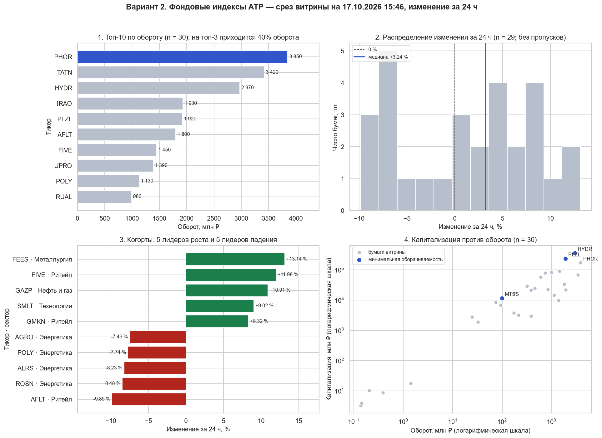
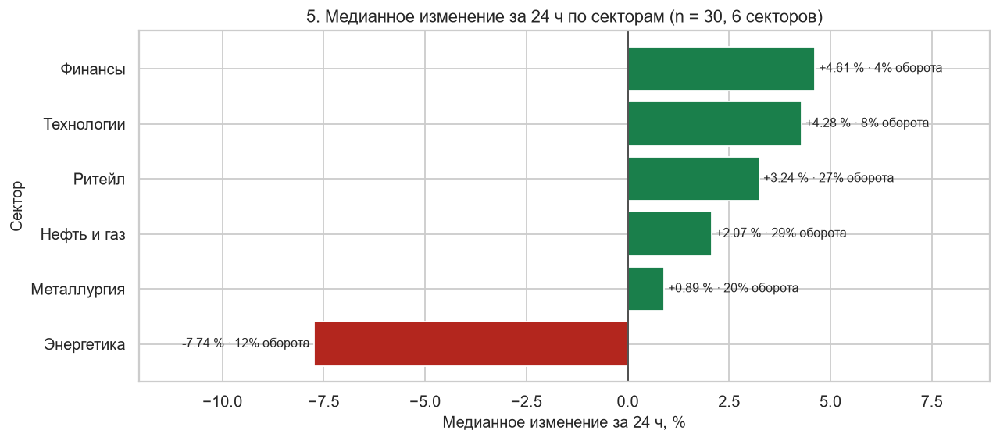
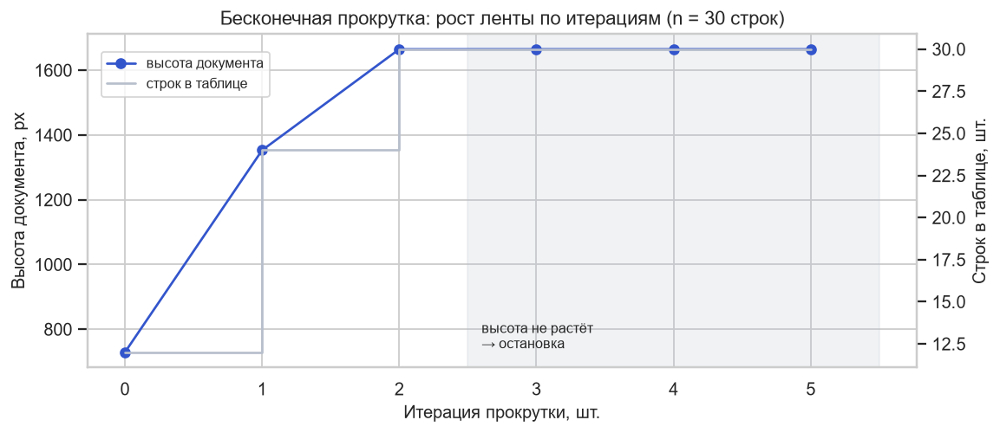

# Лабораторная работа № 1. Парсинг динамических веб-сайтов: Playwright и Selenium

**Направление:** 38.04.05 «Бизнес-информатика», магистратура.
**Вариант 2:** «Фондовые индексы АТР» (профиль учебного стенда `stocks`).

| | |
|---|---|
| **Источник данных** | Учебный динамический стенд (SPA): cookie-баннер, отложенная гидратация 1,2 с, догрузка по кнопке «Показать ещё» |
| **Реальная площадка** | Investing.com — Asia/Pacific indices (краткое исследование, без автоматического сбора) |
| **Аналитическая задача** | Сравнение доходностей, когорты роста и падения; решение — ребалансировка портфеля |
| **Дата сбора** | 17.10.2026 |
| **Стек** | Playwright (async, Chromium headless), `lxml` (XPath), `pandas`, `matplotlib`, `seaborn`, `openpyxl` |

## Содержимое репозитория

| Файл / папка | Что это |
|---|---|
| [`lr1_playwright_variant2.ipynb`](lr1_playwright_variant2.ipynb) | Основной ноутбук со всеми выводами ячеек и комментариями к шагам |
| [`results/lr1_variant02_stocks.xlsx`](results/lr1_variant02_stocks.xlsx) | Очищенные данные: листы `data`, `by_sector`, `quality` |
| [`results/page.png`](results/page.png) | Скриншот полной загруженной витрины (30 из 30 строк), доказательство сбора |
| [`results/page_scroll.png`](results/page_scroll.png) | Скриншот ленты, собранной прокруткой (задание со звёздочкой B) |
| [`images/`](images/) | Графики из ноутбука для этого README |

## Как запустить

1. Нажмите кнопку **Open in Colab** выше или откройте ноутбук в Jupyter.
2. В ячейке «Шаг 1» проверьте параметры: `VARIANT = 2`, `ENGINE = "playwright"`, `USE_LIVE_TARGET = False`.
3. Выполните **«Среда выполнения» → «Выполнить все»**. Ячейки идут строго сверху вниз, Chromium ставится автоматически (1–2 минуты).

Сохранённые выводы получены в локальном Jupyter (Windows, Python 3.12), потому что из внешней сети Colab терял связь со средой. Вне Colab ноутбук сам выбирает рабочую папку `lr1_work` вместо `/content/lr1`, остальной код от среды не зависит.

## Что сделано

| Этап | Реализация | Результат |
|---|---|---|
| 1. Окружение | Chromium с флагами `--no-sandbox`, `--disable-dev-shm-usage`; контекст 1440×900, `ru-RU`, честный User-Agent; блокировка картинок и шрифтов | Браузер стартует, ответ 200 |
| 2. Статика против JS | Подсчёт строк в исходном HTML (то, что видит `requests`) | В исходном HTML **0 строк**, после JS — 12 |
| 3. Препятствия | Каскад селекторов для cookie-баннера (`data-testid` → `translate()`); отсутствие баннера не ошибка | Закрыт 1 баннер |
| 4. Ожидания и догрузка | `wait_for_function` по числу строк вместо `time.sleep`; цикл «клик → ждать роста», не больше 12 кликов; при таймауте сохраняются скриншот и HTML | 12 → 24 → 30 строк за 2 клика |
| 5. XPath и lxml | Браузер отдаёт итоговый HTML, разбор идёт в `lxml` по `data-testid` относительным путём `.//td[...]` | **30 из 30** строк; одна строка через браузер ≈ 30 мс, вся таблица в `lxml` ≈ 4 мс |
| 6. Очистка и Excel | Суффиксы K/M/B, проценты долями, рубли, даты, Unicode-минус, неразрывные пробелы; расчёт через `Decimal`; 11 тестов функций | Объём и капитализация — 100 %, цена и изменение — 97 %; пропуски `n/a` и `—` остались `NaN` |
| 7. Анализ | 4 обязательных графика + сравнение секторов, отчёт для ЛПР | См. ниже |
| ★ B | Бесконечная прокрутка `page.mouse.wheel` на копии стенда; остановка, когда высота документа не растёт 3 итерации подряд | 30 из 30 строк, данные совпадают со сбором по кнопке |

Самопроверка ноутбука: **«Выполнено: 11 из 11»**.

## Результаты

1. **Ликвидность узкая.** На топ-3 бумаги (PHOR, TATN, HYDR) приходится **40 %** оборота, лидер PHOR — 3 850 млн ₽ (15 %).
2. **Режим рынка — умеренный рост.** Медиана изменения за 24 ч **+3,24 %**, растут 62 % бумаг. Разброс большой: от −9,85 % (AFLT) до +13,14 % (FEES).
3. **Секторы расходятся.** Лучший — «Финансы» (медиана **+4,61 %**), худший — «Энергетика» (**−7,74 %**). Разрыв 12,35 п. п. за сутки, в «Энергетике» падают 4 бумаги из 5.

## Рекомендации

1. **Ребалансировка между секторами:** рассмотреть увеличение веса «Финансов» и «Технологий» и сокращение «Энергетики» в пределах коридора ±5 п. п., но только после подтверждения на серии срезов. Проверка — доходность портфеля против равновзвешенного бенчмарка через 5 торговых дней.
2. **Исполнение:** крупные заявки направлять в бумаги топ-10 по обороту. Для HYDR, PLZL и MTSS (оборачивается меньше 1 % капитализации в день) ввести лимит позиции.
3. **Экстремальные движения** больше ±8 % перед решением проверять вручную: они могут быть артефактом низкой базы или разовой сделки.

## Ограничения

* **Нет регионов.** Задача варианта — индексы АТР и региональный портфель, но на стенде акции без признака региона и без истории цен. Сравнение выполнено по доступному полю «сектор», сектора за регионы не выдаются. Для исходной задачи нужны регион (страна) индекса, история значений за период и текущие веса портфеля.
* **«Доходность» — только изменение за 24 ч**, а не доходность за период.
* **Один срез** на 17.10.2026: выводы о тренде делать нельзя.
* **Данные стенда синтетические:** выводы демонстрируют метод, а не рыночный факт.

## Реальная площадка: Investing.com

| Вопрос | Результат |
|---|---|
| robots.txt | Раздел `/indices/` поисковым роботам не запрещён; закрыты служебные разделы и `/indices/*?page=chart` |
| Защита | Cloudflare: прямой запрос к странице индексов получил ответ 403 |
| Условия использования, XHR | Проверить не удалось: текст условий подгружается скриптами, сетевые запросы без обхода защиты не изучить |
| Разрешённый источник | Alpha Vantage (индексы АТР), MOEX ISS API (российский рынок) |

Автоматический сбор с площадки не выполнялся (`USE_LIVE_TARGET = False`).

## Задание со звёздочкой B: бесконечная прокрутка

Лента выросла за 2 итерации (12 → 24 → 30 строк, высота 729 → 1665 px). Ещё 3 контрольные итерации прироста не дали, и цикл остановился. Прокрутка заняла ≈ 7,4 с против ≈ 2,8 с у кнопки: разницу дают контрольные итерации, которые подтверждают конец ленты.

## Этика сбора

* Данные собираются только с собственного учебного стенда.
* User-Agent честный, с пометкой учебного проекта.
* Капча, Cloudflare и stealth-плагины не обходятся, данные за логином и персональные данные не собираются.

