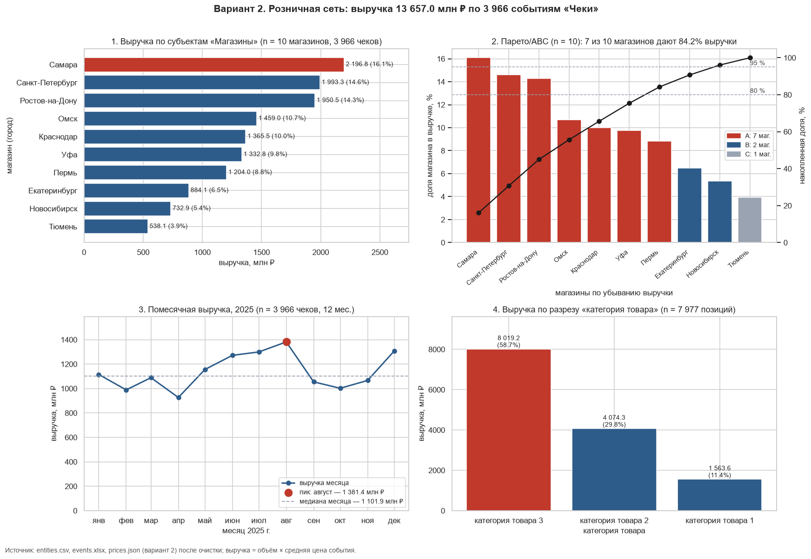
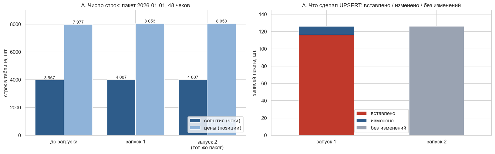

# Лабораторная работа № 2. Консолидация разнородных источников: CSV + Excel + JSON → SQLite → аналитика

**Направление:** 38.04.05 «Бизнес-информатика», магистратура.
**Вариант 2:** «Розничная сеть».

| | |
|---|---|
| **Источники** | Магазины (CSV), Чеки (XLSX), Позиции чека (JSON); генерируются в ноутбуке по номеру варианта |
| **Единица объёма / разрез цен** | единицы товара / категория товара |
| **Аналитическая задача** | ABC-анализ магазинов: какие точки дают 80 % выручки |
| **Стек** | Python 3.12, pandas, NumPy, SQLite, SQL, Matplotlib, seaborn |
| **Дополнительное исследование** | A. Инкрементальная загрузка через UPSERT |
| **Самопроверка ноутбука** | Выполнено: 11 из 11 |

## Цель работы

Освоить полный цикл консолидации данных из нескольких источников: загрузку, проверку качества, очистку, построение реляционной модели, расчёт выручки и формирование обоснованных управленческих решений.

## Главные результаты

* **Выручка сети:** 13 657,0 млн ₽ по 3 966 чекам с ценой.
* **Ответ на задачу варианта:** 80 % выручки дают **7 из 10 магазинов**: Самара, Санкт-Петербург, Ростов-на-Дону, Омск, Краснодар, Уфа, Пермь.
* **Цена ошибки в JOIN:** наивный запрос даёт 27 448,5 млн ₽, то есть завышает выручку в **2,01 раза**.
* **Сверка SQL и pandas:** максимальное расхождение по магазину **0,005 ₽**, это след округления.
* **Качество данных:** 15 проверок из 25 нашли проблемы, в карантине 135 строк (1,1 % событий и цен).
* **Догрузка через UPSERT идемпотентна:** второй запуск того же пакета дал 0 вставок и 0 изменений.

## Содержимое репозитория

| Файл / папка | Что это |
|---|---|
| `ЛБ2_Консолидация_CSV_Excel_JSON_SQLite_вариант2.ipynb` | Основной ноутбук со всеми выводами ячеек |
| `pw2_work/consolidation_variant_2.sqlite` | База SQLite со схемой, данными, карантином и витриной `mart_event_revenue` |
| `pw2_work/mart_variant_2.xlsx` | Выгрузка витрины: ABC, сезонность, категории, события, журналы очистки и качества |
| `pw2_work/consolidation_variant_2_incremental.sqlite` | Копия базы с догрузкой (дополнительное исследование A) |
| `pw2_work/quarantine_events.csv`, `quarantine_prices.csv` | Карантин для разбора с владельцем источника |
| `pw2_work/data/` | Исходные `entities.csv`, `events.xlsx`, `prices.json` |
| `pw2_work/conclusions_variant_2.txt` | Выводы для ЛПР, сформированные кодом |
| `images/` | Графики из ноутбука для этого отчёта |

## Ход работы

### 1. Загрузка источников

Все источники прочитаны без неявного приведения типов: CSV и XLSX с `dtype=str`, JSON через `json.loads`. Ключи `E001`, `EV000001`, `PR0000001` сохранили формат на 100 % строк. В колонке `unit_price` из JSON встречаются значения трёх типов: `float`, `str` и `None`.

| Источник | Строк | Размер |
|---|---:|---:|
| `entities.csv`, магазины | 11 | 0,8 КБ |
| `events.xlsx`, чеки | 4 026 | 148,8 КБ |
| `prices.json`, позиции чека | 8 119 | 1 146,0 КБ |

### 2. Аудит качества

| Измерение | Проверок | С проблемами | Затронуто строк | Что найдено |
|---|---:|---:|---:|---|
| Полнота | 3 | 3 | 31 | 13 чеков без объёма, 17 позиций без цены, 1 магазин без региона |
| Уникальность | 6 | 6 | 134 | 26 дублей чеков, 40 дублей позиций, 1 дубль магазина (счёт по полным дублям и повторам ключа вместе) |
| Согласованность | 5 | 4 | 45 | 13 дат `дд.мм.гггг`, 14 объёмов текстом с пробелом, 17 цен с «₽», 1 имя в верхнем регистре с пробелами |
| Валидность | 4 | 1 | 19 | 19 отрицательных цен |
| Целостность | 4 | 1 | 20 | 20 чеков ссылаются на несуществующий магазин `E999` |
| Точность | 3 | 0 | 0 | выбросов по правилу 3×IQR нет: ни по выборке, ни внутри категории, ни по объёму |

**Кардинальность.** Обе связи имеют тип 1:N.

| Связь | Родителей | Потомков | В среднем | Минимум | Максимум |
|---|---:|---:|---:|---:|---:|
| магазин → чеки | 10 | 4 026 | 366,00 | 20 | 658 |
| чек → позиции | 4 000 | 8 119 | 2,03 | 1 | 4 |

Минимум 20 чеков приходится на `E999`, которого нет в справочнике. Чек с 4 строками появляется из-за дублей позиций. У 67,8 % чеков больше одной ценовой строки, поэтому наивный JOIN должен был завысить объём и выручку примерно вдвое.

### 3. Очистка

Написаны функции `to_number` и `to_date` с мини-тестами. Разбираются числа вида `8 500,00 ₽`, `1,234.50`, `180 ` и оба формата дат. Нераспознанное значение становится пропуском.

| Источник | Исходно | Дубликаты | Карантин | В работе |
|---|---:|---:|---:|---:|
| Магазины | 11 | 1 | 0 | 10 |
| Чеки | 4 026 | 26 | 33 | 3 967 |
| Позиции чека | 8 119 | 40 | 102 | 7 977 |

Для каждого источника проверено равенство «исходно = дубликаты + карантин + в работе». Оно выполняется, значит, ни одна строка не исчезла без записи.

Состав карантина:

| Таблица | Причина | Строк |
|---|---|---:|
| чеки | `entity_id` нет в справочнике | 20 |
| чеки | пропуск объёма | 13 |
| позиции | неположительная цена | 19 |
| позиции | пропуск цены | 17 |
| позиции | чек отсутствует или в карантине | 66 |

Принятые решения:

* Пропуски объёма и цены не заменялись нулями.
* Имя магазина в верхнем регистре возвращено к виду `Магазины «Ростов-на-Дону»`. `str.title()` не использовался, потому что он дал бы «Ростов-На-Дону».
* Пустой регион у одного магазина восстановлен из названия этой же записи. Это единственное заполнение пропуска, оно отражено в журнале очистки.
* Исходные таблицы `raw_*` не изменились, что проверено сравнением отпечатков до и после очистки.
* У одного чека не осталось пригодной цены. Он хранится в базе, но его выручка считается неизвестной и в итог не входит.

### 4. Модель данных и SQL

Схема включает таблицы `entities`, `events`, `prices`, таблицы карантина и витрину `mart_event_revenue`.

* **Ключи:** `PRIMARY KEY` в трёх таблицах, `FOREIGN KEY` для связей чек → магазин и позиция → чек, `PRAGMA foreign_keys = ON`.
* **Ограничения `CHECK`:** объём и цена больше нуля, формат даты и `entity_id`, диапазон года основания.
* **Индексы:** по внешним ключам, дате и категории.

Число строк в базе совпало с очищенными таблицами, `PRAGMA foreign_key_check` не нашёл нарушений. Пять контрольных ошибочных вставок база отклонила: цена ≤ 0, несуществующий магазин, нулевой объём, неверный формат даты, повтор первичного ключа.

**Корректный запрос** сначала сворачивает цены до одной строки на чек, а затем соединяет их с объёмом:

```sql
WITH price_per_event AS (
    SELECT event_id, AVG(unit_price) AS avg_price, COUNT(*) AS price_rows
    FROM prices
    GROUP BY event_id
)
SELECT e.entity_id, e.entity_name, e.region,
       COUNT(ev.event_id)                            AS events_cnt,
       SUM(ev.volume_units)                          AS volume_total,
       ROUND(SUM(ev.volume_units * pe.avg_price)
             / SUM(ev.volume_units), 2)              AS avg_price,
       ROUND(SUM(ev.volume_units * pe.avg_price), 2) AS revenue
FROM entities e
JOIN events ev          ON ev.entity_id = e.entity_id
JOIN price_per_event pe ON pe.event_id  = ev.event_id
GROUP BY e.entity_id, e.entity_name, e.region
ORDER BY revenue DESC;
```

**Эффект fan-out.** Чек `EV000002` с объёмом 310 единиц после JOIN занимает 3 строки, и `SUM(volume)` становится равным 930. Корректная выручка этого чека равна 4 318 859,03 ₽, наивная — 12 956 577,10 ₽.

| Показатель | Наивный JOIN | Корректный расчёт | Завышение |
|---|---:|---:|---:|
| Выручка, млн ₽ | 27 448,5 | 13 657,0 | 2,01 раза |
| Объём | — | — | 2,00 раза |

По магазинам завышение выручки составляет от 1,92 до 2,06 раза. Коэффициент близок к среднему числу позиций на чек после очистки (2,01). Каждая строка чека повторяется по числу его цен, и `SUM` складывает один объём несколько раз.

**Сверка SQL и pandas.** Число чеков совпало по каждому магазину. Итог SQL равен 13 656 992 191,71 ₽, итог pandas — 13 656 992 191,73 ₽. Разница возникает только из-за `ROUND(…, 2)` в SQL.

### 5. Аналитика



**Рейтинг и ABC.** Магазин входит в группу A, если накопленная доля до него меньше 80 %, в группу B — если меньше 95 %. Так группа A становится минимальным набором магазинов, который вместе даёт 80 % выручки.

| № | Магазин | Чеков | Выручка, млн ₽ | Средний чек, млн ₽ | Доля | Накопленно | Группа |
|---:|---|---:|---:|---:|---:|---:|:--:|
| 1 | Самара | 650 | 2 196,8 | 3,38 | 16,1 % | 16,1 % | A |
| 2 | Санкт-Петербург | 579 | 1 993,3 | 3,44 | 14,6 % | 30,7 % | A |
| 3 | Ростов-на-Дону | 564 | 1 950,5 | 3,46 | 14,3 % | 45,0 % | A |
| 4 | Омск | 435 | 1 459,0 | 3,35 | 10,7 % | 55,6 % | A |
| 5 | Краснодар | 405 | 1 365,5 | 3,37 | 10,0 % | 65,6 % | A |
| 6 | Уфа | 386 | 1 332,8 | 3,45 | 9,8 % | 75,4 % | A |
| 7 | Пермь | 337 | 1 204,0 | 3,57 | 8,8 % | 84,2 % | A |
| 8 | Екатеринбург | 245 | 884,1 | 3,61 | 6,5 % | 90,7 % | B |
| 9 | Новосибирск | 197 | 732,9 | 3,72 | 5,4 % | 96,1 % | B |
| 10 | Тюмень | 168 | 538,1 | 3,20 | 3,9 % | 100,0 % | C |

Первые шесть магазинов дают 75,4 %, поэтому порог 80 % пересекается на Перми. При более строгом правиле «накопленная доля ≤ 80 %» в группе A было бы 6 магазинов.

Разрыв между лидером и замыкающим составляет 4,1 раза. Средний чек различается не более чем на 16,2 %, а число чеков — в 3,9 раза. Значит, разницу в выручке создаёт трафик, а не чек.

**Сезонность.** Пик приходится на август (1 381,4 млн ₽), минимум — на апрель (926,7 млн ₽), разрыв 1,49 раза. Июнь–август и декабрь в среднем на 25,2 % выше остальных месяцев.

**Структура по категориям.**

| Категория | Выручка, млн ₽ | Доля выручки | Позиций | Средняя цена, ₽ |
|---|---:|---:|---:|---:|
| Категория товара 3 | 8 019,2 | 58,7 % | 2 675 | 29 539 |
| Категория товара 2 | 4 074,3 | 29,8 % | 2 639 | 15 049 |
| Категория товара 1 | 1 563,6 | 11,4 % | 2 663 | 5 741 |

Число позиций в категориях почти одинаково, поэтому структуру выручки определяет цена.

**Контроль сходимости.** Суммы по магазинам, группам ABC, месяцам, категориям и витрине совпали с итогом. Отклонение итога SQL от pandas равно 0,02 ₽ из-за округления, остальные срезы сходятся точнее.

### 6. Дополнительное исследование A. Инкрементальная загрузка

Эксперимент выполнен на копии базы, основная база не менялась. Пакет «следующего дня» (01.01.2026) содержит 48 чеков и 84 позиции:

* 40 новых чеков с позициями;
* исправления 5 загруженных чеков и 5 позиций;
* дефекты как в исходных данных: дубли внутри пакета, чек с `E999`, цена с «₽», пропуск цены, дата `дд.мм.гггг`, объём с пробелом.

Пакет проходит те же функции очистки. Загрузка идёт через `INSERT … ON CONFLICT DO UPDATE … WHERE … IS NOT …` в одной транзакции, каждый запуск пишется в таблицу `load_log`. Условие `WHERE` обновляет строку только при реальном изменении значений.

| Этап | Чеков | Позиций | Выручка, ₽ |
|---|---:|---:|---:|
| до загрузки | 3 967 | 7 977 | 13 656 992 191,73 |
| после запуска 1 | 4 007 | 8 053 | 13 822 889 290,84 |
| после запуска 2 (тот же пакет) | 4 007 | 8 053 | 13 822 889 290,84 |
| полная перезагрузка «база + пакет» | 4 007 | 8 053 | 13 822 889 290,84 |

| Запуск | Таблица | Получено | Дублей | Карантин | Вставлено | Изменено | Без изменений |
|---:|---|---:|---:|---:|---:|---:|---:|
| 1 | чеки | 48 | 2 | 1 | 40 | 5 | 0 |
| 1 | позиции | 84 | 1 | 2 | 76 | 5 | 0 |
| 2 | чеки | 48 | 2 | 1 | 0 | 0 | 45 |
| 2 | позиции | 84 | 1 | 2 | 0 | 0 | 81 |



**Вывод.** Догрузка идемпотентна: второй запуск ничего не изменил, дублей `event_id` нет. Результат совпал с полной перезагрузкой, разница 0,0017 ₽ связана с накоплением погрешности float. Повторная доставка пакета не задваивает выручку. Удаления в источнике UPSERT не отражает, для них нужен признак удаления или сверка набора ключей за день.

## Выводы и рекомендации

| № | Действие | Основание | Ожидаемый эффект | Способ проверки |
|---:|---|---|---|---|
| 1 | Запустить программу удержания трафика в 7 магазинах группы A | Группа A даёт 84,2 % выручки, разницу между магазинами создаёт число чеков | Рост числа чеков группы A на 3 % даёт около 345,1 млн ₽ в год при неизменном среднем чеке. 3 % — расчётное допущение, а не прогноз | Помесячное сравнение чеков и выручки с прошлым годом и с контрольными магазинами, пересчёт ABC каждый квартал |
| 2 | Планировать запасы и персонал по помесячному профилю, а не по среднему за год | Пик к минимуму 1,49 раза, сезон на 25,2 % выше остальных месяцев | Меньше дефицита в пик и простоя в низкий сезон. Ориентир: доля упущенных продаж в пиковые месяцы не выше, чем в обычные | План-факт выручки и остатков, сравнение точности прогноза по профилю и по среднему |
| 3 | Ввести контроль качества на входе и закрепить регламент «свёртка цен → JOIN» | Завышение в 2,01 раза, 135 строк в карантине, 66 удалённых дублей чеков и позиций | Нет двойного счёта. 4 037 единиц товара из 20 чеков с `E999` вернутся в отчёт после исправления источника | Автотесты «SQL = pandas» и «сумма срезов = итог» при каждой загрузке, доля карантина ≤ 1 % и снижается от выгрузки к выгрузке |

## Ограничения

* **Данные синтетические и охватывают один год.** Тренд и межгодовую сезонность оценить нельзя, рекомендации иллюстрируют метод.
* **Масштаб чека нереалистичен.** Средний чек около 3,4 млн ₽ получается из параметров генератора: объём 60–320 единиц на чек и цены от 2,5 до 47 тыс. ₽. Сравнивать абсолютные суммы с реальной розницей нельзя, опираться стоит на доли и соотношения.
* **Цена чека — простое среднее по позициям.** Количество по категориям неизвестно, поэтому выручка приблизительна.
* **Часть чеков не вошла в выручку.** Это 33 чека в карантине и 1 чек без цены, итог занижен на их долю.
* **Выбросы по 3×IQR не найдены, но это не доказывает точность цен.** Нужна сверка с первичными данными.
* **Сезонное превышение заложено генератором:** он повышает объём в июне–августе и декабре.

## Воспроизводимость

Сохранённые выводы получены в локальном Jupyter (Windows, Python 3.12, pandas 3.0, SQLite 3.53) запуском сверху вниз. В Google Colab ноутбук не запускался. Вне Colab он сам выбирает рабочую папку `pw2_work` вместо `/content/pw2`. Данные детерминированы номером варианта, при запуске в Colab числа должны совпасть, но эта проверка не выполнялась.

Раздел BigQuery необязателен и не выполнялся: `ENABLE_BIGQUERY = False`. Ключи сервисных аккаунтов в работе не используются.
