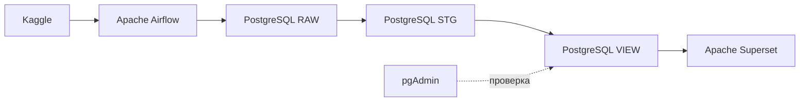
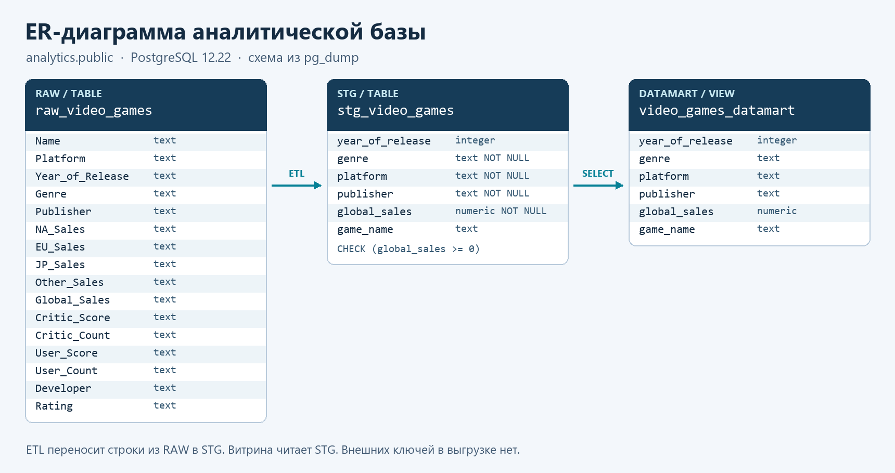
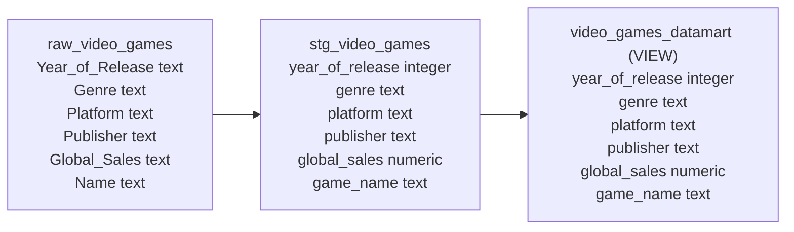
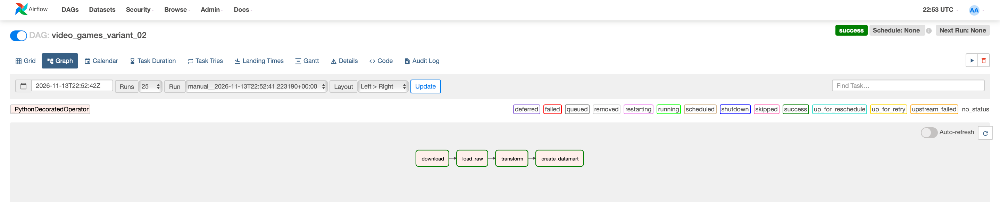
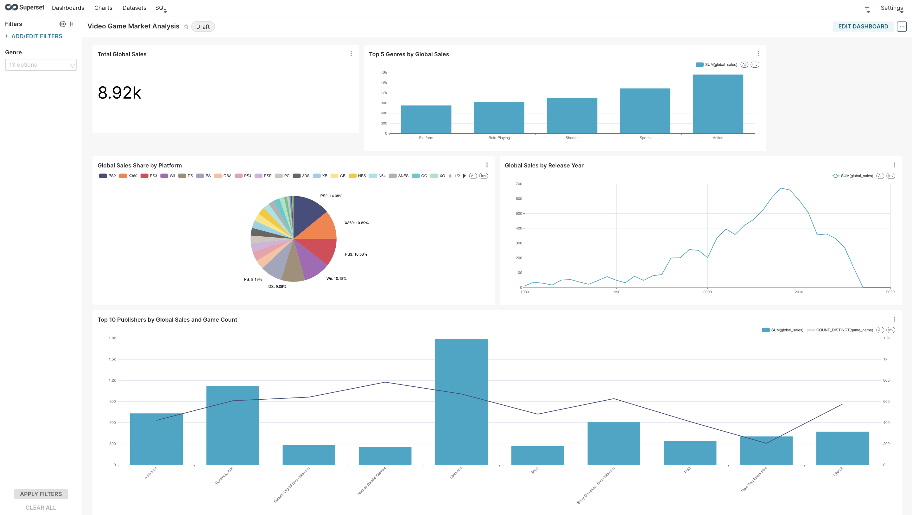
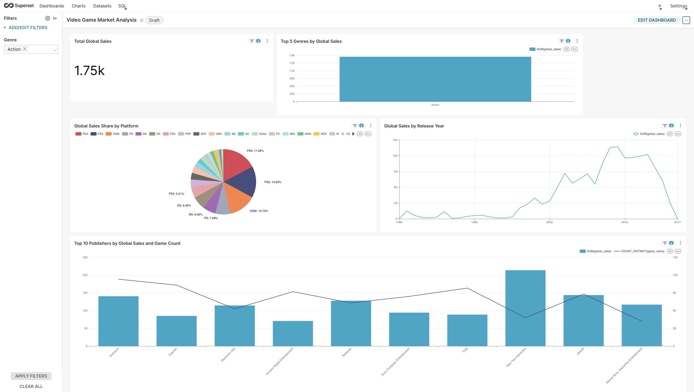

# Лабораторная работа № 3. Анализ рынка видеоигр

Вариант № 2 · Video Game Market Analysis

## 1. Цель

Сравнить мировые продажи видеоигр по жанрам, платформам, издателям и годам выпуска. Дашборд помогает выбрать платформы и издателей для дальнейшего анализа выбранного жанра.

## 2. Метрики

| Метрика | Формула | Применение |
| --- | --- | --- |
| Мировые продажи | `SUM(global_sales)` | Карточка и сравнение по годам выпуска, жанрам и издателям |
| Доля платформы | Продажи платформы / продажи всех платформ в текущей выборке × 100% | Круговая диаграмма |
| Количество игр издателя | `COUNT(DISTINCT game_name)` в разрезе издателя | Линия на правой оси комбинированного графика |

На комбинированном графике обе серии показывают десятку издателей по суммарным продажам в текущей выборке. Карточка использует округлённое отображение Superset.

Лог задачи `download` подтверждает, что использован файл `Video_Games_Sales_as_at_22_Dec_2016.csv`. В описании полей этого CSV `Global_Sales` обозначает общемировые продажи в миллионах экземпляров. Эта единица применяется ко всем значениям `SUM(global_sales)`. [Описание полей CSV](https://gexijin.github.io/learnR/the-game-sales-dataset.html)

## 3. Архитектура



Airflow скачивает CSV и записывает его в исходную таблицу. Следующая задача очищает значения и приводит типы. Завершающая задача создаёт представление для Superset. Отдельная база метаданных Airflow хранит пользователей и состояние задач.

## 4. Стек и окружение

- Фактический запуск — macOS на Apple Silicon, Docker Desktop и Docker Compose v5.1.1.
- В сборке использованы `apache/airflow:2.5.0-python3.8` и `apache/superset:3.1.1`.
- В шаблоне указаны PostgreSQL 12 и Redis 7. PostgreSQL хранит метаданные Airflow и аналитические данные в отдельных сервисах. pgAdmin 4 используется для проверки базы.
- Для работы с данными используются Python, KaggleHub, PostgreSQL provider Airflow и psycopg2.
- В проекте на Mac файл сборки Airflow использует готовый образ. Дополнительная установка компилятора в образе была убрана после ошибок загрузки системных пакетов Debian.

## 5. Схема данных



Диаграмма построена по [выгрузке схемы рабочей базы PostgreSQL 12.22](analytics_schema.sql), полученной через `pg_dump --schema-only`. Она показывает все 16 полей RAW, типы и ограничения STG и шесть полей представления. Стрелки обозначают перенос данных через Airflow и зависимость представления от STG. Внешних ключей в выгрузке нет. Ниже приведена краткая схема полей, используемых в анализе.



## 6. Исходники

- [Сценарий Airflow](dags/video_games_dag.py)
- [SQL-файл витрины](dags/datamart_variant_02.sql)
- Окружение проекта — [Docker Compose](docker-compose.yml), [образ Airflow](Dockerfile) и [образ Superset](superset.Dockerfile).
- [Источник Kaggle](https://www.kaggle.com/datasets/sidtwr/videogames-sales-dataset)
- [Экспорт дашборда Superset 3.1.1](superset/dashboard_export_20261114T000321.zip) — архив YAML с дашбордом, пятью графиками, фильтром Genre, датасетом и настройками подключения.

Для запуска на новом компьютере открой папку проекта в терминале и выполни команды по порядку:

    docker compose up -d postgres
    docker compose exec postgres pg_isready -U airflow -d airflow
    docker compose run --rm --build init
    docker compose up -d --build webserver scheduler analytics_postgres redis superset pgadmin

Запускай `init` после сообщения `accepting connections` при первой настройке базы Airflow. В Airflow (`http://localhost:8080`) создай подключение типа Postgres с именем `analytics_postgres`. По конфигурации проекта хост — `analytics_postgres`, порт — `5432`, база и пользователь — `analytics`. Пароль для локального запуска задан в Compose. Запусти `video_games_variant_02`. В Superset (`http://localhost:8088`) импортируй ZIP из списка **Dashboards**. При запросе пароля для подключения используй пароль аналитической базы из Compose. Если Kaggle потребует авторизацию, используй собственный ключ в локальной папке `dags/.kaggle/`, которую Compose подключает к Airflow.

## 7. Результаты

Все четыре задачи Airflow завершились со статусом `success`.



```sql
CREATE OR REPLACE VIEW public.video_games_datamart AS
SELECT
    year_of_release,
    genre,
    platform,
    publisher,
    global_sales,
    game_name
FROM public.stg_video_games;
```





При фильтре `Action` карточка изменилась с `8.92k` до `1.75k`. На графике жанров остался один столбец. Распределение по платформам, ряд по годам выпуска и десятка издателей пересчитались.

### Сверка с базой

| Показатель | Результат |
| --- | ---: |
| Строк в RAW | 16 719 |
| Строк в STG | 16 719 |
| Строк в витрине | 16 719 |
| Строк без года выпуска | 269 |
| Строк без названия игры | 2 |
| Сумма `global_sales`, млн копий | 8 920,30 |

Все строки из RAW попали в STG и витрину. Точная сумма в PostgreSQL соответствует округлённому значению `8.92k` на карточке Superset. [Результат запроса в SQL Lab](screenshots/sql_check.png)

## 8. Выводы и ограничения

- По округлённым значениям карточки на `Action` приходится около 20% мировых продаж, представленных в наборе. Это крупнейший жанр на графике топ-5. Его стоит выделить в отдельный сегмент при сравнении платформ.
- Без фильтра крупнейшая доля у PS2 (14,08%). Для `Action` лидирует PS3 (17,28%). Лидер зависит от жанра, поэтому при выборе платформы для жанрового анализа следует сравнивать доли внутри нужного сегмента.
- По столбцам без фильтра лидирует Nintendo, а при фильтре `Action` — Take-Two Interactive. Рейтинги издателей полезно сравнивать отдельно по выбранным жанрам.
- Год на линейном графике относится к выпуску игры. 269 строк без года включены в общие продажи и исключены из ряда по годам. В этом запуске при преобразовании не отброшено ни одной строки. Пропуски категорий отмечаются как «Не указано».
- Подсчёт по названию объединяет одноимённые записи одного издателя на разных платформах и может объединить разные игры с одинаковым названием. Две записи без названия входят в сумму продаж и исключаются из подсчёта уникальных названий. Результаты описывают покрытие исходного набора данных.

