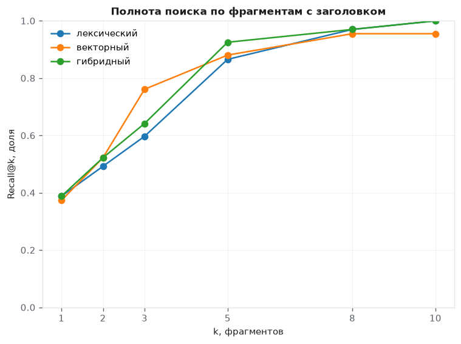
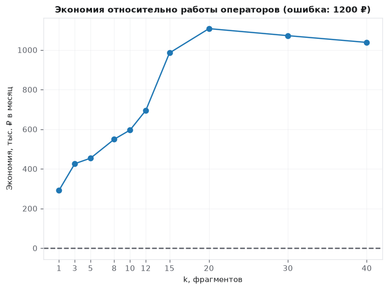
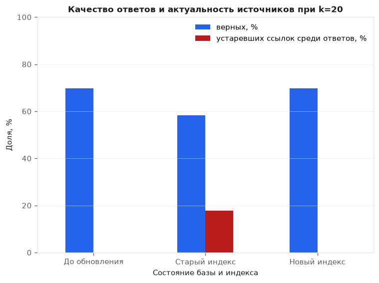

# Лабораторная работа № 4. Интеллектуальные средства анализа (GenAI)

**Вариант 2 — интернет-провайдер.** RAG-ассистент первой линии поддержки абонентов.  
**Фокус B — влияние числа фрагментов контекста на качество и стоимость ответов.**

## Цель работы

Проверить, какую часть из 20 000 обращений в месяц ассистент может обработать по регламентам, как меняются качество и стоимость при расширении контекста и какие условия нужны для запуска пилота.

## Три главных результата

1. **Заголовок помогает найти нужный регламент.** Recall@1 гибридного поиска вырос с **14,9 % до 38,8 %**, а MRR@5 — с **0,388 до 0,573**. Добавление заголовка сохраняет название тарифа рядом с фактом после нарезки документа.
2. **Правило отказа сокращает ответы на вопросы вне базы.** При `k=5` строгий промпт снизил их долю с **86,2 % до 0 %**, сохранив **27 верных ответов**. Маскирование и очистка контекста снизили попадание тестовых ПДн с **14,58 % до 0 %**, а маркера инъекции — с **6,25 % до 0 %**.
3. **После 20 фрагментов дополнительный контекст перестал окупаться на проверенных точках.** При `k=20` доля верных ответов составила **69,79 %**, а расчётная экономия — **1 107 700 ₽ в месяц**. При `k=30` качество осталось прежним, а экономия снизилась на **35 434 ₽ в месяц**.

## Содержимое репозитория

| Файл или папка | Содержимое |
|---|---|
| [lab_04_genai_variant_02.ipynb](lab_04_genai_variant_02.ipynb) | Выполненный блокнот с кодом, комментариями, таблицами, графиками и выводами |
| [images/](images/) | Три графика из блокнота для отчёта |
| `README.md` | Отчёт по основной и дополнительной частям работы |

## Ход работы

### 1. Корпус и фрагментация

С фиксированным зерном `1002` сгенерированы 60 регламентов по восьми темам и 96 обращений. У 67 обращений есть эталонный ответ, 29 выходят за пределы базы. В 14 обращений добавлены синтетические ПДн, в один регламент — учебная промпт-инъекция.

Нарезка по 400 символов с перекрытием 60 символов дала 181 фрагмент. В регламенте `KB-006` название тарифа «Архивный» осталось в первом фрагменте, а срок «11 рабочих дней» оказался во втором. Добавление заголовка вернуло тариф во фрагмент с фактом.

### 2. Сравнение стратегий поиска

Сравнивались лексический поиск TF-IDF, векторный поиск LSA на символьных n-граммах и гибридное ранжирование RRF. Recall@k показывает долю вопросов, для которых эталонный документ попал в первые `k` фрагментов. MRR@5 учитывает позицию первого совпадения в пределах пяти фрагментов. Метрики рассчитаны на 67 вопросах с эталоном.

| Фрагменты | Поиск | Recall@1 | Recall@5 | MRR@5 |
|---|---|---:|---:|---:|
| Без заголовка | Лексический | 16,4 % | 91,0 % | 0,384 |
| Без заголовка | Векторный | 11,9 % | 76,1 % | 0,327 |
| Без заголовка | Гибридный | 14,9 % | 85,1 % | 0,388 |
| С заголовком | Лексический | 38,8 % | 86,6 % | 0,536 |
| С заголовком | Векторный | 37,3 % | 88,1 % | 0,555 |
| С заголовком | Гибридный | 38,8 % | 92,5 % | 0,573 |

Гибридный поиск по фрагментам с заголовками выбран для следующих этапов по наибольшим Recall@5 и MRR@5.

### 3. Качество ответов и правило отказа

Для обоих промптов использовались один поток обращений и один индекс. При `k=5` на вопросы с эталоном базовый режим дал 29 ответов с источником, из них 27 верных. Строгий режим сохранил все 27 верных ответов и отказался в двух случаях, где базовый режим ошибся. На вопросы вне базы базовый режим ответил 25 раз из 29, а строгий отказался во всех 29 случаях.

В одном из неверных ответов базовый режим привёл **41 рабочий день** со ссылкой на `KB-002#1`. Пользователь спрашивал суточный лимит для тарифа «Расширенный», а по `KB-042` он составлял **31 заявку**. Этот случай показывает, зачем отдельно измерять наличие источника и совпадение с эталонным фактом.

### 4. Проверка защиты

| Сценарий при k=5 | ПДн в промпте | Маркер инъекции в промпте | Верные ответы от всех обращений |
|---|---:|---:|---:|
| Без защиты | 14,58 % | 6,25 % | 28,13 % |
| Маскирование ПДн | 0 % | 6,25 % | 28,13 % |
| Маскирование и очистка контекста | 0 % | 0 % | 28,13 % |

Маскирование проверялось на синтетических телефонах, адресах электронной почты, номерах карт и СНИЛС. Очистка контекста убрала известную тестовую вставку. В эксперименте измерялось попадание маркера в промпт шаблонного генератора.

### 5. Экономика и фокусный эксперимент

В расчёте используются 20 000 обращений в месяц, 85 ₽ за обработку оператором, 1,8 ₽ за 1 000 токенов промпта и 1 200 ₽ за ошибочный ответ. При базовой конфигурации `k=5` месячные затраты снизились с **1 700 000 до 1 245 908 ₽**. Из новой суммы 1 221 875 ₽ приходятся на обработку отказов операторами и 24 033 ₽ — на промпты. Экономия составила **454 092 ₽ (26,7 %)**.

В строгом прогоне при `k=5` ошибок не зафиксировано, поэтому изменение цены ошибки от 0 до 10 000 ₽ оставило экономию прежней. Для оценки чувствительности пилота при 1 % ошибок от общего потока и прежних остальных затратах запас экономии исчерпается примерно при **2 270 ₽ за ошибку**.

Гипотеза фокусного эксперимента заключалась в том, что больший контекст помогает найти больше нужных фактов, но после насыщения качества дальнейший расход токенов снижает экономию. В обязательном диапазоне от 1 до 10 фрагментов экономия продолжала расти, поэтому проверка была расширена до 40.

| Фрагментов | Верных от всех обращений | Средний промпт, токенов | Экономия, ₽ в месяц |
|---:|---:|---:|---:|
| 1 | 17,71 % | 255 | 291 867 |
| 3 | 26,04 % | 459 | 426 177 |
| 5 | 28,13 % | 668 | 454 092 |
| 8 | 34,38 % | 964 | 549 671 |
| 10 | 37,50 % | 1 156 | 595 873 |
| 12 | 43,75 % | 1 348 | 695 231 |
| 15 | 61,46 % | 1 657 | 985 134 |
| 20 | 69,79 % | 2 188 | 1 107 700 |
| 30 | 69,79 % | 3 172 | 1 072 266 |
| 40 | 69,79 % | 4 120 | 1 038 124 |

При 20 фрагментах ассистент верно закрыл все 67 вопросов с эталоном, а 29 обращений вне базы передал оператору. При переходе к 30 фрагментам число верных ответов не выросло, а средний промпт прибавил 984 токена. Поэтому 20 — лучший из проверенных вариантов по расчётной экономии.

### 6. Задание со звёздочкой. Мониторинг деградации

Изменены числовые факты в 12 из 60 регламентов и соответствующие эталоны. При `k=20` сравнивались три состояния. Во всех использовались одинаковые обращения, строгий промпт, маскирование и очистка контекста.

| Состояние | Верных ответов из 96 | Отказов | Ссылок на устаревшие документы среди выданных ответов |
|---|---:|---:|---:|
| До обновления | 67 (69,79 %) | 30,21 % | 0 % |
| Регламенты обновлены, индекс старый | 56 (58,33 %) | 30,21 % | 17,91 % |
| Индекс пересобран | 67 (69,79 %) | 30,21 % | 0 % |

Доля отказов не изменилась, хотя качество снизилось на 11,46 п. п. Для мониторинга можно сравнивать версию или хеш процитированного документа в индексе с актуальной версией в базе. В эксперименте этот индикатор отметил 12 из 67 выданных ответов со старым индексом и вернулся к нулю после пересборки.

## Выводы и рекомендации

Запускать ассистента в ограниченном пилоте: сначала показывать подсказки операторам, затем разрешать автономные ответы на типовые вопросы о тарифах и сроках при однозначном источнике. Споры о списаниях, возвраты, компенсации и обращения без подходящего источника передавать оператору.

В пилоте сравнить `k=20` с меньшим контекстом на реальном потоке. По ручной выборке отслеживать долю ошибок среди автономных ответов отдельно по категориям. Дополнительно измерять долю отказов, расход токенов и долю ссылок на устаревшие документы. По фактической цене ошибок и стоимости обработки пересчитать экономию перед расширением пилота.

## Ограничения

- Корпус синтетический. В реальных обращениях встречаются неоднозначные формулировки, неполные сведения и противоречащие друг другу версии регламентов.
- Поиск использует LSA, генератор работает по детерминированным шаблонам. При переходе к нейросетевым эмбеддингам или языковой модели качество и затраты могут измениться.
- Число токенов оценено по длине текста. В расчёте не учитывались задержка, сопровождение и стоимость токенов ответа.
- Проверка защиты ограничена одной учебной вставкой и четырьмя форматами синтетических ПДн. Проверка актуальности источника выявляет устаревший индекс. Верность ответа по актуальному регламенту оценивается отдельно.

## Воспроизводимость

Откройте [блокнот](lab_04_genai_variant_02.ipynb) в Jupyter или Google Colab и выполните все ячейки сверху вниз. Для запуска нужны Python, NumPy, pandas, scikit-learn и Matplotlib. Внешние данные и ключи API не требуются. Блокнот выполнен локально, выводы всех 16 ячеек сохранены. Самопроверка — **10 из 10**.
